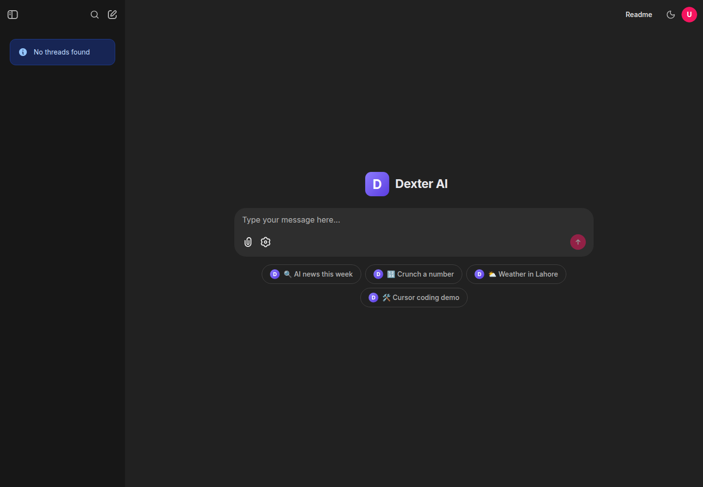
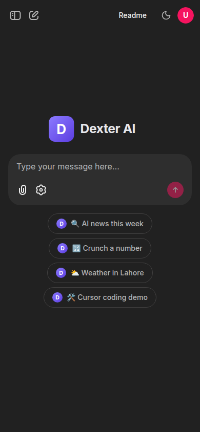
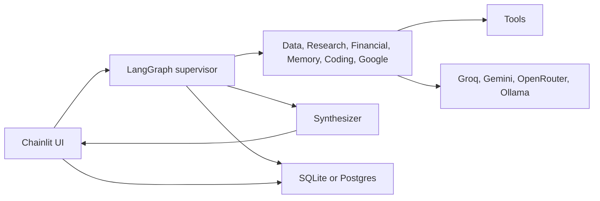
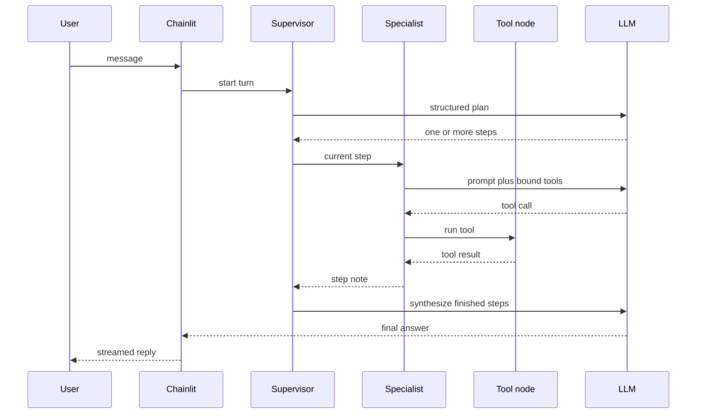

# Dexter

Chainlit chatbot that routes each message through a LangGraph supervisor to specialist tool-calling agents.

[](https://www.python.org/)
[](https://www.langchain.com/langgraph)
[](https://chainlit.io/)
[](https://hub.docker.com/r/zeeshanyq/agenticbot)
[](LICENSE)
[](https://github.com/Zeeshanx186/Agentic-Chatbot-Using-LangGraph/actions/workflows/cicd.yaml)

## What it does

Dexter is a single-operator chat app. The supervisor writes a short plan, hands each step to the agent that owns the right tools, and a synthesizer writes the final reply. Purchases, outbound email, and calendar deletes pause for an Approve / Decline prompt. Chats persist in SQLite, or in Postgres when `DATABASE_URL` is set.

There is no public user base and no reported traffic in this repository. These shots are the real Chainlit welcome screen from a local process (`chainlit run dexter/chainlit_app.py`). No message was sent, so they show the shell and starter prompts, not a model reply.





## Tools

| Tool | Agent | What it uses |
| --- | --- | --- |
| `web_search` | Research | Tavily, then DuckDuckGo if Tavily fails. Refuses queries that belong to the weather or stock tools |
| `fetch_url` | Research | Fetches one URL with size and address checks |
| `wikipedia` | Research | Wikipedia summaries |
| `retriever_tool` | Research | FAISS over uploaded PDFs (`all-MiniLM-L6-v2`) |
| `extract_text_from_image` | Research | RapidOCR |
| `inspect_table` | Data | Preview of a CSV or Excel upload |
| `run_pandas_code` | Data | Sandboxed pandas. Arithmetic is supposed to go through this tool, not a separate calculator |
| `plot_data` | Data | Chart spec stored beside the chat, rendered as text in Chainlit |
| `get_stock_price` | Financial | Alpha Vantage global quote, labeled when it is a prior close |
| `get_stock_history` | Financial | Alpha Vantage daily history |
| `purchase_stock` | Financial | Simulated buy. Interrupts for approval. Does not place a real order |
| `get_weather` | Financial | OpenWeather |
| `remember`, `recall`, `forget` | Memory | Facts in SQLite, or Postgres when cloud storage is on |
| `get_current_datetime` | Memory | Clock, optional IANA timezone |
| `cursor_coding_agent` | Coding | Cursor Cloud Agent against a GitHub repo (`CURSOR_API_KEY`, optional `CURSOR_DEMO_REPO`) |
| `gmail_search_emails`, `gmail_read_email`, `gmail_create_draft` | Google | Gmail API. Desktop OAuth (`credentials.json`) |
| `gmail_send_email` | Google | Sends mail. Interrupts for approval |
| `calendar_list_events`, `calendar_create_event` | Google | Calendar API |
| `calendar_delete_event` | Google | Deletes an event. Interrupts for approval |

Uploads accepted by the Chainlit config: PDF, PNG, JPEG, CSV, and Excel. PDFs are indexed for retrieval. Images can be OCR'd. Spreadsheets go to the data tools.

The model picker lists local Ollama models (if the daemon responds), Groq chat models, Gemini when `GOOGLE_API_KEY` is set, and free OpenRouter tool-calling models when `OPENROUTER_API_KEY` is set. The default model is Groq `qwen/qwen3.6-27b`. `set_model` can also build an OpenAI client, but the picker does not offer OpenAI rows.

## Architecture





A step with no tool call returns straight to the supervisor. `purchase_stock`, `gmail_send_email`, and `calendar_delete_event` raise a LangGraph interrupt; Chainlit shows Approve / Decline and resumes the graph with `yes` or `no`.

## Tech stack

- Python 3.11+ (`.python-version` is 3.12; the image and CI use 3.11)
- LangGraph and LangChain, Chainlit 2.12
- Groq by default; optional Google AI Studio, OpenRouter, Ollama, and an OpenAI code path
- FAISS and sentence-transformers for PDF retrieval
- SQLite checkpointer locally; Postgres via `langgraph-checkpoint-postgres` when `DATABASE_URL` is set
- Docker image `zeeshanyq/agenticbot`, GitHub Actions, a Vercel ASGI entry, and an Oracle Compose file

## Quick start

Install [uv](https://docs.astral.sh/uv/), then from the repository root:

```bash
uv sync
cp .env.example .env
uv run chainlit run dexter/chainlit_app.py
```

Open http://localhost:8000. `GROQ_API_KEY` and `TAVILY_API_KEY` have to be present or the process fails while importing `dexter.backend`. Fill the other keys for the tools you want. See [Environment](#environment).

### Docker

Prebuilt image:

```bash
docker run -d --name dexter -p 8000:8000 --env-file .env zeeshanyq/agenticbot:latest
```

Build from this repo (context is the root, Dockerfile is under `deploy/`):

```bash
docker build -f deploy/Dockerfile -t zeeshanyq/agenticbot:latest .
docker run -d --name dexter -p 8000:8000 --env-file .env zeeshanyq/agenticbot:latest
```

The image listens on port 8000, runs as a non-root user, and reads env vars at start. Changing `.env` needs a restart, not a rebuild. Do not put spaces around `=` in `.env`. Docker's `--env-file` parser keeps them, and providers then reject the key.

The first build is large because of CPU torch and the embedding stack. `deploy/requirements.txt` starts with the PyTorch CPU index so the image does not pull the CUDA wheels.

### Vercel

`vercel.json` points at `dexter/vercel_app.py` (`dexter.vercel_app:app` in `pyproject.toml`). When `VERCEL` is set, the process refuses to start unless `DATABASE_URL`, `CHAINLIT_AUTH_SECRET`, and `DEXTER_STAGING_PASSWORD` are set. Sign-in username is `dexter`. Uploads through that entry are capped at 4 MB. `GET /healthz` checks the database when cloud storage is enabled.

### Oracle / Compose

From the repo root, on a host that already has `/srv/dexter.env`:

```bash
docker compose -f deploy/compose.oracle.yaml up --build -d
```

The service publishes `127.0.0.1:8000` only, drops capabilities, and mounts the repo over `/app`. `scripts/deploy_oracle_secrets.py` is meant to be run on that server. It writes `/srv/dexter.env` once and stores the generated password in the Ubuntu home directory. It does not print the password.

## Environment

Names and meaning are listed in [`.env.example`](.env.example). Nothing in that file is a secret.

| Variable | Required | Used for |
| --- | --- | --- |
| `GROQ_API_KEY` | yes, to import the app | Default LLM |
| `TAVILY_API_KEY` | yes, to import the app | `web_search` (DuckDuckGo is the fallback after Tavily fails) |
| `OPENWEATHER_API_KEY` | for weather | `get_weather` |
| `ALPHAVANTAGE_API_KEY` | for stocks | quote and history |
| `GOOGLE_API_KEY` | optional | Gemini rows in the picker |
| `OPENROUTER_API_KEY` | optional | Free OpenRouter models in the picker |
| `OPENAI_API_KEY` | optional | `set_model` provider `openai` only |
| `OLLAMA_HOST`, `OLLAMA_BASE_URL` | optional | Local model discovery and calls |
| `GROQ_MAX_TOKENS` | optional | Caps Groq generations |
| `CURSOR_API_KEY`, `CURSOR_DEMO_REPO`, `CURSOR_AUTO_CREATE_PR` | for the coding demo | `cursor_coding_agent` |
| `GOOGLE_CREDENTIALS_FILE`, `GOOGLE_TOKEN_FILE` | for Gmail and Calendar | OAuth client and cached token |
| `CHAINLIT_AUTH_SECRET` | for Chainlit auth | Session signing |
| `DEXTER_STAGING_PASSWORD` | staging / Vercel | Password auth. Username is `dexter` |
| `DATABASE_URL` | Vercel and any cloud store | Postgres. Unset means local SQLite |
| `LANGSMITH_*` | optional | Tracing |
| `WEATHERSTACK_API_KEY` | no | Passed through CI. The weather tool does not read it |
| `HF_HOME` | no | Embedding cache directory |

Google OAuth is a desktop flow: enable the Gmail and Calendar APIs, create a Desktop OAuth client, and save it as `credentials.json` (or the path in `GOOGLE_CREDENTIALS_FILE`). The first successful login writes `token.json`. Both filenames are gitignored.

## Project structure

```
chainlit.md              Chainlit welcome page (must sit at the app root)
.chainlit/               Chainlit config and UI strings
public/                  Favicon and logos served by Chainlit
vercel.json              Vercel function config
dexter/                  Application package
  backend.py             Graph, tools, model switching
  chainlit_app.py        Chainlit UI
  chainlit_data_layer.py Thread list, titles, feedback
  chat_store.py          History helpers and model catalog
  cloud_store.py         Postgres objects, checkpoints, memories
  google_tools.py        Gmail and Calendar
  vercel_app.py          FastAPI + Chainlit mount for Vercel
tests/                   Unittest modules
deploy/                  Dockerfile, pip requirements, Oracle Compose
scripts/                 Server-side staging secret helper
docs/                    Deployment guides and screenshots
```

Chainlit resolves `.chainlit/`, `public/`, and `chainlit.md` from the process working directory. Run commands from the repository root. Local runtime files (`agentic_chatbot.db`, `chat_titles.json`, `uploads/`, `faiss_db/`) are written at that root and are gitignored.

`pyproject.toml` plus `uv.lock` are what `uv sync` installs. `deploy/requirements.txt` is what the image installs. They can drift. The image does not install the project as a wheel; it copies `dexter/` onto `/app`.

## Testing

```bash
uv run python -m unittest discover -s tests -v
```

`tests.test_google_tools` and `tests.test_staging_auth` do not need API keys. `tests.test_cloud_deployment` is skipped unless `DATABASE_URL` is set; it writes UUID-scoped rows and deletes those rows afterward.

```bash
uv run flake8 . --count --select=E9,F63,F7,F82 --exclude .venv,venv,.git,__pycache__
```

That is the same hard check as CI. The style report in the workflow is advisory.

## Deployment and CI

[`.github/workflows/cicd.yaml`](.github/workflows/cicd.yaml) runs on pushes and pull requests to `main`, and on manual dispatch.

| Job | Where | What |
| --- | --- | --- |
| `lint` | `ubuntu-latest` | flake8. Syntax and undefined names fail the job. Style does not |
| `push_to_registry` | `ubuntu-latest` | Build `deploy/Dockerfile`. Pull requests build only. `main` pushes `:main`, a short SHA tag, and `:latest` |
| `continuous_deployment` | self-hosted | `main` only. Checks four API secrets, pulls `:main`, replaces container `dexter`, polls `GET /` inside the container |

The deploy job also stops a container named `stapp`, the old Streamlit name, so a reused host does not leave it behind. The previous EC2 host for this pipeline was terminated on 2026-08-25. A new self-hosted runner has to be registered before that job can go green. The account id, instance id, and address are not in the current docs.

Longer notes: [docs/DEPLOYMENT.md](docs/DEPLOYMENT.md) and [docs/CICD-FROM-SCRATCH.md](docs/CICD-FROM-SCRATCH.md). Vercel and the Oracle Compose file are separate from this workflow.

## Roadmap

These are gaps in the current code, not promised features.

- Keep `pyproject.toml` and `deploy/requirements.txt` from drifting, or build the image from `uv.lock`.
- `WEATHERSTACK_API_KEY` is forwarded by CI and unused by `get_weather`.
- The OpenAI provider exists in `set_model` and is absent from the Chainlit picker.
- Google OAuth expects a local browser on first login. A headless host needs a `token.json` created elsewhere.
- The self-hosted deploy job has nowhere to run until a runner is registered again.

## License

[Apache License 2.0](LICENSE).
